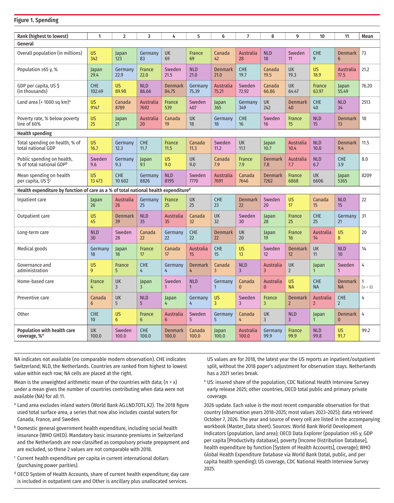

# Health Care Spending in the United States and Other High-Income Countries: 2026 Data Update

This repository rebuilds the seven ranked comparison figures (Figures 1, 4, 5, 7, 9, 10 and 11) from

> Papanicolas I, Woskie LR, Jha AK. **Health Care Spending in the United States and Other High-Income Countries.** *JAMA.* 2018;319(10):1024-1039. doi:[10.1001/jama.2018.1150](https://doi.org/10.1001/jama.2018.1150)

with the newest comparable data available in October 2026. It follows the original paper's sources and definitions as closely as possible. The figures use the same layout, the same 11 countries (US, UK, Germany, Sweden, France, Netherlands, Switzerland, Denmark, Canada, Japan, Australia) and the same ranking convention as the original.

This is an independent student project. It is not affiliated with the original authors or with JAMA, and it has not been peer reviewed.



## Outputs

| File | What it is |
|---|---|
| [`outputs/Papanicolas2018_figures_2026_update.pdf`](outputs/Papanicolas2018_figures_2026_update.pdf) | All 7 recreated figures, in the paper's order |
| [`outputs/figures/`](outputs/figures) | Each figure as a 300-dpi PNG, an SVG and a PDF |
| [`outputs/Papanicolas2018_modern_update.xlsx`](outputs/Papanicolas2018_modern_update.xlsx) | Main workbook: figure inventory, source map and audit status, the master dataset (source, year and URL for every value), the figure matrices, the remuneration calculations, a change log, research gaps and QC |
| [`outputs/data/master_modern_dataset.csv`](outputs/data/master_modern_dataset.csv) | Master dataset in machine-readable form: 99 indicators × 11 countries = 1,089 rows |
| [`outputs/Papanicolas2018_rank_changes_2018_vs_2026.xlsx`](outputs/Papanicolas2018_rank_changes_2018_vs_2026.xlsx) | How each country's rank moved between the 2018 paper and 2026, and whether it now does better or worse relative to the other countries |
| [`outputs/Rank_change_matrices_2018_vs_2026.pdf`](outputs/Rank_change_matrices_2018_vs_2026.pdf) | Two-page summary of the rank changes |
| [`outputs/validation/figures_2018_reproduction/`](outputs/validation/figures_2018_reproduction) | The same renderer drawing the paper's original 2018 values, to check the layout against the published figures |

## Reproducing the results

The repository includes snapshots of the raw data downloaded on October 7, 2026. One command rebuilds every output from them, with no network access:

```bash
pip install -r requirements.txt   # Python 3.10+: openpyxl, matplotlib, numpy
./run_all.sh                      # about 2 minutes
```

`run_all.sh` takes these steps:

1. Decompress the raw snapshots.
2. Build the indicator specification.
3. Run one build script per data source (`raw/` → `results/`).
4. Assemble the master dataset and run the quality checks.
5. Draw the figures.
6. Write the Excel workbooks.

LibreOffice is optional; it is only used to export the rank-change PDF. The workbooks contain live formulas that Excel, LibreOffice or Google Sheets compute when the file is opened.

**What reproduces exactly:** I rebuilt the project from a fresh copy of this repository. Every results file, the master dataset, every figure (PNG, SVG and PDF) and the rank-change workbook came out identical to the committed versions.

The one exception is the traceability test in the QC table, which checks that each value appears in a saved raw file. For 6 indicators it reports extra `REVIEW` flags, because the values come from documents this public repository does not redistribute: Medscape, KFF, the Japanese health ministry (MHLW), and text copies of Commonwealth Fund and OECD reports. The committed `outputs/data/qc_results.csv` and the workbook's QC sheet come from the full run, which had those documents.

## How the data were built

**Rules**

- **Same source, newest year.** For each indicator, the most recent comparable observation is taken from the source the 2018 paper used, or from that source's official successor. The source preference order is:
  1. OECD Data Explorer / Health Statistics
  2. Health at a Glance
  3. World Bank WDI
  4. WHO
  5. Commonwealth Fund surveys
  6. Official national statistics
  7. Industry sources
- **Years differ by country and indicator.** Each country's latest year is used and recorded separately. Nothing is interpolated or modelled. Missing values are NA.
- **No mixed definitions.** A value is plotted only if it uses the same definition as the other countries in its row. Values that are excluded stay in the dataset, with the reason in the `orchestrator_decision` column.
- **Comparability status.** Every indicator is rated with one of these labels:

  | Status | Indicators |
  |---|---|
  | `DIRECTLY UPDATED` | 54 |
  | `CLOSE MODERN EQUIVALENT` | 33 |
  | `NOT COMPARABLE` | 2 |
  | `UNAVAILABLE` | 10 |

  Indicators rated not comparable or unavailable are shown as NA in the figures. The `Source_Map` sheet explains each rating.
- **Conventions kept from the paper:**
  - Rows are ranked from highest to lowest value, whether a high value is good or bad.
  - The Mean column is the unweighted mean of the countries with data. When fewer than 11 countries have data, the figure shows the count as `(n = x)`.
  - Physician and nurse pay is converted to 2025 US dollars with the US CPI-U, as the paper converted to 2017 dollars.

**Research process: AI-assisted.** The data collection was organised with Anthropic's Claude, using several research agents. Each agent covered one group of sources:

- OECD spending and capacity
- OECD population health and utilization
- OECD quality and equity
- World Bank and WHO
- Commonwealth Fund
- Pharmaceuticals
- Country-specific sources

A separate agent built the figure renderer. Agents downloaded the data through official APIs (OECD SDMX, World Bank, WHO) and wrote the build scripts in `scripts/`. Their shared instructions are in [`spec/AGENT_BRIEF.md`](spec/AGENT_BRIEF.md). Decisions on comparability, such as excluding a value or switching to a consistent definition, are written into `scripts/final/build_final.py` and documented in the workbook's change log.

**Values read from published reports.** Most values come straight from database downloads. About a dozen were read from published reports and are recorded with page or table references in `results/*_data.csv`. See [`docs/SOURCES.md`](docs/SOURCES.md) for the full list. These include:

- Commonwealth Fund 2023 survey tables (via CIHI) and Commonwealth Fund briefs
- OECD *Health for Everyone?* (2019), for the horizontal inequity index
- IDF Diabetes Atlas, for diabetes prevalence
- EFPIA 2026
- Medscape 2026 and the Japanese health ministry, for US and Japanese physician pay
- KFF

**Checks**

- Rank order, duplicates, 11 countries per row, and means recomputed independently.
- One unit per row, and magnitudes compared with the 2018 values, to catch mix-ups between percentages and fractions, per-1,000 and per-100,000 rates, or nominal and PPP dollars.
- Every value has a source URL and a year, and every value matches the raw file it came from.
- The Excel formulas were checked against the figure data: 0 mismatches in 1,089 values.

**These checks are automated. The dataset has not been verified by hand by an independent reviewer.** If you plan to use it for teaching or research, please spot-check rows you know well.

## Main caveats

- **Data years are mixed.** Most values are from 2023–2025. Some are older: US hospital utilization data in OECD are still from 2009–2010, which is also what the 2018 paper used, and several survey measures are from 2020–2023.
- **Ten indicators could not be updated:**
  - the 2015 Bloomberg comparison of four drug prices
  - neonatal mortality excluding births under 1,000 g
  - the three health-system views questions (not asked since 2016)
  - "foreign body left in during a procedure" (discontinued by OECD)
  - asthma admissions relative to prevalence (no official prevalence series)
- **Two indicators exist but aren't comparable:** total pharmaceutical spending and new chemical entities.
- **Some definitions changed:**
  - **Primary care share:** OECD no longer separates general internists, so one narrower OECD definition is applied to all countries.
  - **Land area:** used instead of surface area, because the World Bank's surface-area series now includes coastal waters for Canada, France and Sweden.
  - **Public spending:** WHO now classifies Swiss and Dutch mandatory insurance as private, so those two values are footnoted as not comparable with 2018.
  - **Long-term care beds:** OECD now counts beds in institutions only.

  Every such change is footnoted in the figures and listed in the workbook's `Change_Log`.
- **The rank-change file shows relative standing, not absolute improvement.** It ranks countries only among those with comparable data in both years. The desirable direction assigned to each indicator (for example, higher life expectancy is better) is a judgment call and can be edited in the `Directions` sheet.

## Repository layout

```
run_all.sh            rebuild everything
spec/                 indicator definitions with the 2018 values, figure notes, country colors, agent brief
raw/<source>/         raw data snapshots (large files are gzipped; unpacked by scripts/unpack_raw.py)
scripts/<source>/     one build script per data source (raw/ -> results/), plus download helpers
scripts/final/        master dataset, QC, figure notes, workbooks, rank changes
scripts/viz/          figure renderer (matplotlib) and fonts (Fira Sans, SIL OFL)
results/              per-source results: <source>_data.csv (11 rows per indicator) and <source>_audit.csv
outputs/              figures, workbooks, master dataset, QC, 2018 reproduction check
docs/SOURCES.md       documents used but not redistributed, with links
```

## Updating the data

Each value's source query or page is in the `url` column of `results/*_data.csv` and the master dataset. To refresh:

1. Re-run the OECD, World Bank and WHO queries into `raw/`. The helpers `scripts/oecd_health/download.sh`, `scripts/oecd_spend/fetch.sh` and `scripts/pharma/fetch.sh` cover some of them.
2. Update any values read from reports in the relevant build script.
3. Run `./run_all.sh`.

Natural next update: the Commonwealth Fund 2026 International Health Policy Survey, expected in December 2026, may restore the health-system views questions in Figure 10.

## Data sources and licenses

- **Code:** MIT License (see `LICENSE`).
- **Data**, redistributed under their providers' terms, with attribution:
  - OECD data: CC BY 4.0
  - World Bank WDI: CC BY 4.0
  - WHO Global Health Expenditure Database and Global Health Observatory: CC BY-NC-SA 3.0 IGO
  - Eurostat: reuse with acknowledgement
  - US BLS, CDC NCHS and AHRQ HCUP: public domain
  - Canadian Institute for Health Information (Commonwealth Fund survey data tables): reproduced unaltered for non-commercial purposes, © CIHI
  - Diabetes prevalence values cited from the IDF Diabetes Atlas, 11th edition
- **Not included:** the JAMA article and its supplements (© American Medical Association), and copyrighted reports and web pages. Links are in [`docs/SOURCES.md`](docs/SOURCES.md).

## Citation

If you use this update, please cite the original article above and this repository:

> alflayyeh. *Health Care Spending in the US and Other High-Income Countries: 2026 Data Update* (GitHub repository), 2026. https://github.com/alflayyeh/Healthcare
